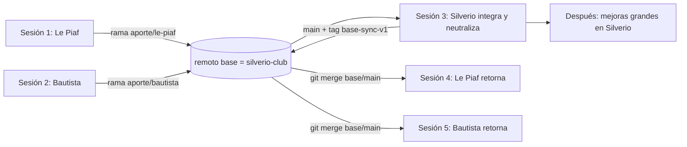

# Roadmap de sincronización: base (Silverio) + 2 copias

Documento para ejecutar en **sesiones distintas**. Cada sesión es autónoma: tiene su diagnóstico, sus pasos, su "listo cuando" y su plan de rescate. Al terminar cada una se completa la **bitácora** (sección 10).

> [!IMPORTANT]
> Regla de trabajo (DelgadoDev): cada `commit`, `push`, `merge` o deploy se **propone y espera el OK explícito del usuario**. Este roadmap describe qué hacer; no autoriza nada por sí solo.

---

## 1. Objetivo y modelo

- **`silverio-club` = base.** Todo lo genérico (panel, Functions, reglas, `packages/shared`, scripts, docs) se cambia **solo ahí**.
- **Cada copia (Le Piaf, Bautista)** cambia **solo lo visual y propio del local** (web pública, kit, marca, `.env`).
- Para que **no se rompa de nuevo**, la base incluye barreras (hook, manifiesto sellado, CI; sección 8b) que impiden commitear cambios genéricos en una copia.
- Para llegar ahí hay que hacerlo en dos tiempos: primero **subir** a la base lo genérico que cada copia tocó por su cuenta, y después **bajar** la base ya unificada a cada copia.



**Son 3 sesiones grandes como pediste, más 2 retornos cortos (4 y 5).** Los retornos no se pueden evitar: la copia solo recibe lo nuevo cuando la base ya está lista. Conviene hacerlos **antes** de las mejoras grandes, para comprobar que el mecanismo funciona con poco riesgo.

---

## 2. Estado verificado hoy (2026-11-03)

**Le Piaf** (`d:\programacion\PROYECTOS_REACT_10_OCTUBRE_2026\LePiaf2026`), verificado:
- Remotos: `base` = `https://github.com/Delgadoc86/silverio-club.git`, `origin` = `https://github.com/Delgadoc86/le-piaf.git`. Rama `main`, igual a `origin/main`.
- Historial compartido con la base: último ancestro común `4a1a6f8`. Le Piaf tiene **1 commit propio** (`e57433a`) y la base **no tiene commits nuevos** según la referencia local (puede estar desactualizada: el `fetch` no se pudo hacer desde el sandbox).
- **Hay trabajo sin commitear** (riesgo de pérdida): 5 archivos de `components/publico` y `(sitio)/page.tsx`, `scripts/seed.ts`, y todo el kit `lepiaf/` (fotos, logo, `seed.json`, manual). Sin trackear: `apps/web/public/`, fotos nuevas y PDFs/HTML comerciales en `lepiaf/manual/`.
- El panel (`components/panel`), `functions/`, `packages/shared` y las reglas son **idénticos a la base**. Eso es lo que hace fácil el retorno.
- Cambios **genéricos** hechos solo en Le Piaf: `scripts/seed.ts` (variantes explícitas, más un cambio sin commitear), `scripts/subir-assets.ts` (`.jfif`), `apps/web/src/features/sitio/json-ld.ts` (imágenes SEO).
- Valores **fijos del local** que chocan en cada merge: `scripts/entorno.ts` (línea con `lepiaf/seed.json`), `package.json` (`name`), `apps/web/.env.example`, `.firebaserc`, `functions/.env.le-piaf`.
- La carpeta del kit se renombró `silverio/` → `lepiaf/`. Si la base toca `silverio/**`, la copia verá conflictos "modificado en base / borrado en la copia".

**No verificado** (el sandbox bloqueó el acceso fuera del workspace; se verifica en la sesión correspondiente):
- Repo de Bautista: `RotiseriaBautista\RotiseriaBautista2026` (carpeta anidada). Tiene `.git` y un kit `bautista/`. Se desconoce si tiene el remoto `base`, si comparte historial con la base y qué cambios genéricos hizo.
- Estado real de `silverio-club` en GitHub, y si hay un clon local. No hay carpeta `silverio-club` junto a los otros proyectos.
- `qrevento2026` **no es una copia de Silverio** (es otro proyecto Next.js sin workspaces). Queda fuera de este roadmap.

---

## 3. Clasificación de archivos

| Tipo | Rutas | Dónde se edita |
|---|---|---|
| **Genérico** | `apps/web/src/components/panel/**`, `components/ui/**`, `app/panel/**`, `app/(auth)/**`, `app/api/**`, `app/layout.tsx`, `app/globals.css`, `features/**`, `lib/**` | **Solo base** |
| **Genérico** | `packages/shared/**`, `functions/src/**`, `firestore.rules`, `storage.rules`, `firestore.indexes.json`, `tests/**`, `scripts/**`, `.github/**` | **Solo base** |
| **Genérico** | Configs raíz (`eslint.config.js`, `tsconfig.base.json`, `pnpm-workspace.yaml`, `firebase*.json`, `.prettier*`, `.gitattributes`, `pnpm-lock.yaml`, `package.json` salvo `name`) y docs (`README.md`, `CLAUDE.md`, `ROADMAP.md`) | **Solo base** |
| **Propio del local** | Carpeta del kit (`lepiaf/`, `bautista/`, `silverio/`) | Solo su copia |
| **Propio del local** | `apps/web/src/components/publico/**`, `apps/web/src/app/(sitio)/**`, `apps/web/public/**` | Solo su copia (cambios visuales) |
| **Propio del local** | `.firebaserc`, `functions/.env.<proyecto>`, `apps/web/.env.example`, `ROADMAP_<LOCAL>*.md` | Solo su copia |

**Zona gris:** `components/publico/tienda/hoja-carrito.tsx`, `hoja-producto.tsx` y `seguimiento.tsx` están en la carpeta "visual", pero llaman a `crearPedido` y a Firebase. Un cambio de lógica de pedidos hecho en la base **va a chocar** con el diseño de cada copia. Regla: la lógica nueva va en `features/` o `lib/` (genérico) y el componente visual solo la consume. Si un cambio igual toca estos archivos, se resuelve a mano en cada retorno.

**Pathspec de exclusión** (para ver solo lo genérico). Se usa en las sesiones 1 y 2:

```powershell
$EXCL = ':(exclude)lepiaf', ':(exclude)bautista', ':(exclude)silverio', ':(exclude)apps/web/src/components/publico', ':(exclude)apps/web/src/app/(sitio)', ':(exclude)apps/web/public', ':(exclude).firebaserc', ':(exclude)functions/.env.*', ':(exclude)apps/web/.env.example', ':(exclude)ROADMAP_*.md'
git diff --stat base/main HEAD -- . $EXCL
```

---

## 4. Cómo se pasan datos entre sesiones

Los chats no comparten memoria. El canal es el **remoto `base` (GitHub `silverio-club`)** y este documento:

1. Cada copia sube una **rama de aporte** al remoto de la base (`aporte/le-piaf`, `aporte/bautista`). No toca `main`. Es durable y visible desde cualquier sesión.
2. Cada sesión deja un **tag de respaldo local** y un **bundle** (`git bundle`) fuera del repo.
3. Este documento se copia como `SINCRONIZACION.md` dentro de la rama de aporte (así viaja con el código) y la **bitácora** (sección 10) se completa al cerrar cada sesión.

> [!NOTE]
> Las operaciones que usan red (`git fetch`, `git push`) pueden requerir permiso fuera del sandbox. Se piden por separado, solo ese comando.

---

## 5. Sesión 1: Le Piaf (este repo)

**Carpeta de trabajo:** `d:\programacion\PROYECTOS_REACT_10_OCTUBRE_2026\LePiaf2026`

### Paso 0. Respaldo (antes de tocar nada)
Con tu OK, guardar este documento en la raíz como `SINCRONIZACION.md` y copiar **el mismo archivo** a la carpeta de Bautista y al clon de Silverio, para que cada chat lo lea. Se commitea en la rama de aporte (paso 4), y de ahí viaja a todos.
```powershell
git status --short
git log --oneline -3
git tag respaldo/pre-sync-lepiaf
git bundle create D:\programacion\respaldos\lepiaf-pre-sync.bundle --all
```
Además, copiar a mano la carpeta `lepiaf/` y `apps/web/public/` a `D:\programacion\respaldos\` (son los archivos sin commitear y los más difíciles de reconstruir).
**Listo cuando:** existen el tag, el bundle y la copia de carpetas.

### Paso 1. Poner a salvo el trabajo sin commitear (en commits separados)
No usar `git add .`. Revisar con `git diff` y proponer commits por tema, esperando el OK de cada uno:
1. `feat(web): ajustes visuales de portada, cabecera, info y promos` (solo `components/publico/**` y `(sitio)/page.tsx`).
2. `feat(lepiaf): fotos, logo, seed y manual` (solo `lepiaf/**`).
3. `chore(web): assets públicos` (`apps/web/public/**`).
4. `fix(scripts): <descripción>` (solo `scripts/seed.ts`). **Commit propio**, porque se va a subir a la base. Antes, mirar `git diff scripts/seed.ts` y decidir si el cambio es genérico o propio del local.

Observación: hay fotos `.jfif` de 2 a 3 MB en el kit. No es parte de la sincronización, pero choca con la regla de imágenes WebP del `CLAUDE.md`. Anotarlo como pendiente.

**Listo cuando:** `git status --short` no muestra nada. Después, `git push origin main` (con OK).

### Paso 2. Traer el estado real de la base
```powershell
git fetch base --prune
git rev-parse base/main
git merge-base HEAD base/main
git log --oneline HEAD..base/main
```
Anotar los dos hashes en la bitácora.
**Si `HEAD..base/main` muestra commits:** la base avanzó. Hay que revisarlos antes de seguir; los aportes se arman sobre `base/main` actual.

### Paso 3. Listar lo genérico que difiere
```powershell
git diff --stat base/main HEAD -- . $EXCL
```
Esperado: `scripts/seed.ts`, `scripts/subir-assets.ts`, `json-ld.ts` (genéricos); `scripts/entorno.ts`, `package.json` (valores fijos del local, **no se aportan**: se neutralizan en la sesión 3). Cualquier otro archivo del panel, Functions, shared o reglas es **inesperado**: frenar y revisar con el usuario.

### Paso 4. Armar la rama de aporte sobre la base
```powershell
git switch -c aporte/le-piaf base/main
git checkout main -- scripts/seed.ts scripts/subir-assets.ts apps/web/src/features/sitio/json-ld.ts
git status
git diff --cached
```
Al cambiar a `base/main` desaparece de la vista `lepiaf/` y vuelve `silverio/`. Es normal; ya está en `main` y en el respaldo.
- Revisar cada diff: solo debe verse el cambio genérico, sin textos de Le Piaf.
- Verificar: `pnpm typecheck` y `pnpm lint`. **No se corren tests** salvo que el aporte toque `firestore.rules` o `storage.rules`.
- Copiar este documento como `SINCRONIZACION.md` en la raíz.
- Commit propuesto: `feat(scripts): variantes explicitas, .jfif y json-ld con foto del local (aporte de Le Piaf)`.

### Paso 5. Publicar el aporte
```powershell
git push base aporte/le-piaf
git ls-remote base
git switch main
git status --short
```
**Listo cuando:** `ls-remote` muestra `refs/heads/aporte/le-piaf`, `main` está limpio y `lepiaf/` volvió a verse.
**No hacer en esta sesión:** `git merge base/main` ni tocar `main` de la base.

### Rescate (sesión 1)
- Algo raro con los commits: `git reset --hard respaldo/pre-sync-lepiaf` (solo con OK) o restaurar desde el bundle.
- Archivos de `lepiaf/` perdidos: se recuperan desde la copia manual del paso 0.
- `git switch` falla por cambios sin guardar: volver al paso 1, no forzar.

---

## 6. Sesión 2: Rotisería Bautista

**Carpeta de trabajo:** `D:\programacion\PROYECTOS_REACT_10_OCTUBRE_2026\RotiseriaBautista\RotiseriaBautista2026`. Abrir el chat con **esa carpeta como workspace**, o el sandbox no la va a leer.

Misma plantilla que la sesión 1 (pasos 0 a 5, con `aporte/bautista` y `lepiaf` reemplazado por `bautista`), más estos pasos **previos** de diagnóstico:

### Paso D1. Remotos e historial
```powershell
git remote -v
git branch -a
git log --oneline -10
git status --short
```
- Si no existe `base`: `git remote add base https://github.com/Delgadoc86/silverio-club.git`.
- Luego `git fetch base --prune` y `git merge-base HEAD base/main`.
  - **Devuelve un hash:** comparten historia. Seguir con la plantilla de la sesión 1.
  - **No devuelve nada:** historias **no relacionadas**. Ver "Contingencia C" abajo.

### Paso D2. Secretos
En la raíz hay `service-account.json` y `revalidate-secret.txt`. Comprobar:
```powershell
git check-ignore -v service-account.json revalidate-secret.txt
git log --all --oneline -- service-account.json revalidate-secret.txt
```
**Listo cuando:** ambos están ignorados y el log no muestra commits. Si alguno se subió alguna vez, **frenar**: hay que rotar esa clave antes de seguir (decisión del usuario).

### Paso D3. Diferencias genéricas
Con el pathspec `$EXCL` de la sección 3 (agregando `':(exclude)bautista'`, que ya está incluido), listar qué difiere. A diferencia de Le Piaf, **aquí no se sabe** qué tocó. Clasificar cada archivo en:
- Genérico útil (se aporta).
- Valor fijo del local (no se aporta).
- Duplicado de lo que ya aportó Le Piaf (no se aporta; se resuelve en la sesión 3).

Si la diferencia es grande (por ejemplo un módulo nuevo en el panel), no se aporta todo junto: **una rama por tema** (`aporte/bautista-<tema>`).

### Documentos
`README.md`, `CLAUDE.md` y `ROADMAP.md` de Bautista son copias del original. Si los editó, aportar solo lo que sea genérico. Lo propio del local va en un archivo aparte, como hizo Le Piaf con `ROADMAP_LE_PIAF_ANTIGRAVITY.md`.

### Contingencia C: sin historial común con la base
1. El aporte **se arma igual** (rama desde `base/main` con `git checkout <rama-de-la-copia> -- <rutas genéricas>`): funciona sin historia compartida.
2. El retorno (sesión 5) se hace así, para dejar de ser "historias no relacionadas":
```powershell
git switch -c sync/retorno-1
git merge -s ours --allow-unrelated-histories base/main -m "chore: enlazar historia con la base"
git checkout base/main -- <rutas genéricas>
git diff --stat base/main HEAD -- . $EXCL
```
Listo cuando el último comando no muestra nada. De ahí en más, los merges son normales.

---

## 7. Sesión 3: Silverio (integración y neutralización)

**Carpeta de trabajo:** un clon nuevo. Abrir el chat con esa carpeta como workspace.
```powershell
git clone https://github.com/Delgadoc86/silverio-club.git D:\programacion\PROYECTOS_REACT_10_OCTUBRE_2026\silverio-club
```

> [!WARNING]
> Silverio es un **cliente en producción**. Si Vercel despliega al empujar a `main`, nada se integra directamente ahí: todo en la rama `integracion/sync-1` y a `main` solo con prueba local y OK.

### Paso 0. Respaldo
```powershell
git tag respaldo/pre-sync-base
git bundle create D:\programacion\respaldos\silverio-pre-sync.bundle --all
git branch -r
```
**Listo cuando:** se ven `origin/aporte/le-piaf` y `origin/aporte/bautista` (más las que se hayan abierto por tema). Si falta alguna, la sesión correspondiente no terminó: no seguir.

### Paso 1. Integrar los aportes
```powershell
git switch -c integracion/sync-1 main
git merge --no-ff origin/aporte/le-piaf
git merge --no-ff origin/aporte/bautista
```
Reglas para los conflictos:
- Mismo archivo genérico en dos aportes: conservar la **unión** de ambos cambios; no elegir uno y perder el otro. Si no es obvio, preguntar.
- Nada de `lepiaf/`, `bautista/` ni `components/publico` debe entrar a la base. Verificar con `git diff --stat main integracion/sync-1`.

### Paso 2. Neutralizar los valores fijos (para que los merges futuros no choquen)
1. **`scripts/entorno.ts`:** quitar el nombre de carpeta escrito a mano. Orden de resolución del kit: `--kit` → variable `KIT` → la **única** carpeta de la raíz que tenga `seed.json`. Si hay más de una, error claro pidiendo `--kit`.
2. **`package.json`:** `name` neutro (por ejemplo `local-base`). Es un nombre sin uso real.
3. **`.prettierignore`:** `silverio/assets` → patrón que cubra cualquier kit (`*/assets`).
4. **`.gitattributes`:** marcar con `merge=ours` los archivos propios de cada copia que existen en la base:
```
.firebaserc merge=ours
apps/web/.env.example merge=ours
```
   Y documentar en el README que **cada clon debe correr una vez** `git config merge.ours.driver true`.
5. **Docs:** `README.md` y `CLAUDE.md` dicen "Silverio" y `silverio/`. Dejar claro que es la **base**. Alcanza con una nota; no hace falta reescribirlos.

### Paso 3. Instalar las barreras (sección 8b)
Todo genérico, en la misma rama `integracion/sync-1`:
1. `scripts/guardia.mjs` con los comandos `sellar`, `verificar` y `pre-commit`. Es Node sin dependencias, para que ande igual en Windows. La lista de rutas "permitidas" vive dentro del script.
2. `.githooks/pre-commit`, que llama a `node scripts/guardia.mjs pre-commit`.
3. En el `package.json` raíz: `"prepare"` (activa `core.hooksPath=.githooks`) y `"base:sellar"`. Comprobar que `prepare` corre con `pnpm install` en pnpm 11.
4. Un paso `node scripts/guardia.mjs verificar` en `.github/workflows/ci.yml`.
5. Sección "Copia vs base" en `CLAUDE.md`, y en el README (guía "duplicar para un local nuevo") dos pasos nuevos: crear `.repo-role` y desactivar el push al remoto `base`.
6. Sellar: `pnpm base:sellar` genera `.base-manifest.json`.
7. Probar las barreras en un clon de prueba: crear `.repo-role` con `rol=copia`, editar un archivo genérico y comprobar que el commit **se bloquea**; editar uno de `components/publico` y comprobar que **pasa**.

### Paso 4. Verificación (sin tests, salvo reglas)
```powershell
pnpm install --frozen-lockfile
pnpm typecheck
pnpm lint
node scripts/guardia.mjs verificar
pnpm dev
```
En `pnpm dev`, revisar a mano con el kit de Silverio: carta pública, hacer un pedido, verlo en `/panel/pedidos`, abrir y cerrar caja.
Si algún aporte tocó `firestore.rules` o `storage.rules`: ahí sí `pnpm test:reglas` (seguridad crítica).

### Paso 5. Cierre
Con el OK del usuario (el manifiesto debe estar sellado **después** del último cambio genérico):
```powershell
git switch main
git merge --no-ff integracion/sync-1
pnpm base:sellar
git tag base-sync-v1
git push origin main --tags
```
Verificar `/api/salud` en producción de Silverio. **Deploy de Functions o reglas** a producción solo si esos archivos cambiaron, y con OK explícito del usuario.
**Listo cuando:** `main` tiene el tag `base-sync-v1`, las ramas `aporte/*` quedan como historial (no se borran todavía) y la bitácora tiene el hash final.

### Rescate (sesión 3)
- Mal merge antes de empujar: `git merge --abort`, o `git reset --hard respaldo/pre-sync-base`.
- Ya empujado a `main` y algo se rompe: `git revert -m 1 <merge>` (nunca `push --force`).

---

## 8. Sesiones 4 y 5: retorno a cada copia (cortas)

Se hace en cada copia, en este orden: **Le Piaf**, después **Bautista**.

### Paso 0. Respaldo y estado limpio
```powershell
git status --short
git tag respaldo/pre-retorno-1
git config merge.ours.driver true
```
`git status` debe estar vacío. Si no, volver a commitear antes de seguir.

### Paso 1. Merge en una rama de prueba
```powershell
git fetch base --prune
git switch -c sync/retorno-1
git merge base/main
```
Resolución de conflictos esperados:

| Archivo | Qué hacer |
|---|---|
| `scripts/entorno.ts`, `scripts/seed.ts`, `scripts/subir-assets.ts`, `json-ld.ts` | Quedarse con la **versión de la base** (ya incluye lo aportado). |
| `package.json` | Versión de la base. |
| `.firebaserc`, `apps/web/.env.example` | Versión de la copia (los protege `merge=ours`). |
| `silverio/**` ("borrado en nuestra rama") | Dejarlo borrado: `git rm -r silverio`. |
| `components/publico/**`, `(sitio)/**` | Versión de la copia. Si la base cambió lógica de pedidos, integrar a mano. |
| Cualquier otro archivo genérico | Versión de la base. Si el conflicto es en código genérico, es señal de que hubo un cambio local que se saltó este roadmap: parar y preguntar. |

### Paso 2. Verificación
```powershell
pnpm install --frozen-lockfile
pnpm typecheck
pnpm lint
pnpm dev
```
Probar con el kit de la copia: carta pública, pedido, panel, caja. Correr `pnpm seed` solo contra emuladores. **Nunca** apuntar a producción.
Chequeo de divergencia: `node scripts/guardia.mjs verificar` debe pasar sin diferencias. Si falla, lista exactamente qué archivo genérico difiere: es una divergencia no resuelta (resolver con la versión de la base, o frenar y preguntar).

### Paso 3. Activar las barreras en esta copia
```powershell
# crear .repo-role (rol=copia y kit=<carpeta del kit>), con OK
pnpm install
git config core.hooksPath
git remote set-url --push base DESACTIVADO
git remote -v
```
Comprobar que `core.hooksPath` devuelve `.githooks` y que el push a `base` figura desactivado. Probar el hook: intentar commitear un cambio en un archivo genérico (debe bloquearse) y revertirlo.

### Paso 4. Cierre
Con el OK del usuario:
```powershell
git switch main
git merge --no-ff sync/retorno-1
git push origin main
```
Después, deploy de Vercel (automático o manual). Deploy de Functions y reglas **solo si cambiaron**, con OK explícito y contra el proyecto de esa copia (`-P prod`).

**Listo cuando:** `node scripts/guardia.mjs verificar` pasa, el hook bloquea ediciones genéricas, el push a `base` está desactivado y la bitácora tiene el hash de `main`.

---

## 8b. Barreras permanentes (las "trabas")

Objetivo: que un error tuyo (o de un agente en otro chat) **no pueda dejar cambios sueltos** en una copia. En una copia solo se permite lo visual y propio del local. Todo lo demás se cambia en Silverio.

### Qué se permite y qué no en una copia

| Permitido en una copia | Prohibido en una copia (se hace en Silverio) |
|---|---|
| Carpeta del kit (`lepiaf/`, `bautista/`): datos, textos, fotos, manual | Panel, Functions, reglas, `packages/shared`, scripts |
| `apps/web/src/components/publico/**` y `app/(sitio)/**` (diseño de la web pública) | `components/ui`, `features/**`, `lib/**`, `app/panel/**`, `app/api/**` |
| `apps/web/public/**` (logo, fotos) | Dependencias (`package.json`, `pnpm-lock.yaml`) |
| `.firebaserc`, `functions/.env.<proyecto>`, `apps/web/.env.example` | Configs raíz, CI, `README.md`, `CLAUDE.md`, `ROADMAP.md` |
| `ROADMAP_<LOCAL>*.md`, `PENDIENTES_BASE.md`, `.repo-role` | El propio sistema de barreras (`scripts/guardia.mjs`, `.githooks/**`, `.base-manifest.json`) |

Si estando en una copia aparece algo genérico, **no se arregla ahí**: se anota en `PENDIENTES_BASE.md` (permitido) y se hace en Silverio.

### Las 6 capas (de más suave a más dura)

1. **Reglas escritas.** `CLAUDE.md` (que viaja a todas las copias) incorpora una sección "Copia vs base": lo primero que debe hacer un agente es leer `.repo-role`; si dice `rol=copia`, solo puede tocar las rutas permitidas y, ante cualquier otra, frena y lo anota en `PENDIENTES_BASE.md`.
2. **Marcador de rol `.repo-role`.** Existe **solo en las copias** (la base no lo tiene, así no se pisa en los merges):
   ```
   rol=copia
   kit=lepiaf
   ```
3. **Hook `pre-commit` (local).** En una copia, bloquea el commit si toca una ruta fuera de la lista de "permitido". Excepciones:
   - Los commits de merge desde la base (existe `.git/MERGE_HEAD`).
   - Emergencias: `ALLOW_BASE_EDIT=1`. Deja una deriva que la capa 4 marca en rojo hasta que se porte a la base.
   El hook vive en `.githooks/` (versionado en la base) y se activa solo con `core.hooksPath`, configurado por un script `prepare` al hacer `pnpm install`.
4. **Manifiesto sellado + CI (la red de seguridad).** `.base-manifest.json` guarda el hash (sha256, con saltos de línea normalizados) de **cada archivo genérico**. En la base, `pnpm base:sellar` lo regenera **antes de cada tag**. `node scripts/guardia.mjs verificar` corre en GitHub Actions y falla si un archivo genérico difiere del manifiesto o si hay archivos extra en zonas genéricas. No necesita red ni saber el rol, y atrapa también los commits hechos con `--no-verify`.
5. **Remoto `base` de solo lectura en las copias.** Una vez terminadas las sesiones 1 y 2:
   ```powershell
   git remote set-url --push base DESACTIVADO
   ```
   Así nadie empuja a la base por accidente desde una copia. Para un aporte excepcional se restaura la URL a mano.
6. **GitHub (manual).** Proteger `main` en cada repo exigiendo que el CI pase. En repos privados del plan gratuito esta función puede no estar disponible: verificarlo. Si no está, las capas 3 a 5 cubren.

**Lo que NO se hace:** que la verificación bloquee el build de Vercel. Un local caído un viernes a las 22 hs es peor que una deriva. Alcanza con CI en rojo y el aviso.

### Límite honesto
Son trabas contra **errores**, no contra sabotaje: se pueden saltear con `--no-verify` o borrando `.repo-role`. Por eso la capa 4 no depende de ninguna de las dos y deja el CI en rojo, que es lo que te avisa.

### Cómo trabaja la zona gris
`hoja-carrito.tsx`, `hoja-producto.tsx` y `seguimiento.tsx` mezclan diseño y lógica de pedidos, y están en una carpeta permitida. Mejora para hacer en Silverio: mover esa lógica a `features/` y dejar los componentes solo con el diseño. Mientras tanto, se pueden editar en una copia **solo en lo visual**.

---

## 9. Después: mejoras grandes en Silverio

Con las 3 sesiones y los 2 retornos hechos, el flujo normal queda así:
1. Cambio genérico: **solo en `silverio-club`**, en una rama `feat/<tema>`, probado con el kit de Silverio, y luego a `main`.
2. Cada copia, cuando le toque: `git fetch base` + `git merge base/main` (sección 8) + deploy.
3. Cambio visual de una copia: solo en su repo, **sin tocar** las rutas genéricas.

Las mejoras pendientes salen del análisis anterior (impresión de comanda, PWA con Wake Lock, ocultar Cocina y Salón, caja automática, stock del día, etc.) y se arman en otra sesión, con su propio plan para aprobar.

---

## 10. Prompts de arranque (copiar y pegar)

**Sesión 1 (Le Piaf)**
> Estamos en el repo de Le Piaf. Lee `roadmap_sincronizacion.md` (o `SINCRONIZACION.md`) y ejecuta la **Sesión 1** paso a paso. Respeta mi regla de oro: propone cada commit, push o merge y espera mi OK. Frena ante cualquier cosa inesperada. Al final completa la bitácora.

**Sesión 2 (Bautista)**
> Estamos en el repo de Rotisería Bautista. Lee el roadmap de sincronización y ejecuta la **Sesión 2**, empezando por los pasos de diagnóstico D1 a D3. No asumas que comparte historial con la base: verifícalo. Mismas reglas: todo commit y push con mi OK.

**Sesión 3 (Silverio)**
> Estamos en un clon nuevo de `silverio-club`. Lee el roadmap y ejecuta la **Sesión 3**. Todo en la rama `integracion/sync-1`; a `main` solo con prueba local y mi OK explícito. No despliegues nada sin que lo confirme.

**Sesiones 4 y 5 (retorno)**
> Estamos en el repo de `<Le Piaf | Bautista>`. Lee el roadmap y ejecuta el **retorno** (sección 8). Empieza verificando que `git status` esté limpio y que exista `base-sync-v1` en `base`.

---

## 11. Qué puede salir mal

| Riesgo | Prevención |
|---|---|
| Perder trabajo sin commitear (Le Piaf lo tiene hoy) | Paso 0 y paso 1 de la sesión 1: bundle, copia manual y commits por tema |
| Una sesión pisa lo que hizo otra | Cada sesión escribe en su propia rama de aporte; `main` de la base solo cambia en la sesión 3 |
| Entra a la base algo propio de un local (fotos, textos) | Aportes armados con `git checkout <rama> -- <rutas genéricas>`, revisados con `git diff --cached` |
| Se filtran secretos (Bautista tiene `service-account.json` en la raíz) | Paso D2: `check-ignore` y búsqueda en el historial antes de cualquier push |
| Se rompe Silverio en producción | Integración en rama, prueba local, deploy solo con OK; rescate con `git revert -m 1` |
| El sandbox no deja leer otra carpeta | Abrir cada chat con la carpeta de ese repo como workspace |
| Conflictos repetidos en cada merge | Paso 2 de la sesión 3 (neutralizar `entorno.ts`, `package.json`, `merge=ours`) |
| Divergencia nueva por un arreglo hecho en una copia | Barreras permanentes (sección 8b): hook, manifiesto sellado + CI y push a `base` desactivado |
| El hook bloquea una emergencia real (viernes 22 hs) | `ALLOW_BASE_EDIT=1` para ese commit; el CI queda en rojo hasta portar el arreglo a Silverio |
| Se olvida sellar el manifiesto antes de un tag | El CI de la base lo detecta (manifiesto desactualizado); `pnpm base:sellar` es el último paso del cierre |

---

## 12. Bitácora (completar al cerrar cada sesión)

| Sesión | Fecha | Hash de `base/main` visto | Merge-base | Rama o tag resultante | Estado | Notas |
|---|---|---|---|---|---|---|
| 1 Le Piaf | 2026-11-03 | 4a1a6f8 | 4a1a6f8 | `aporte/le-piaf` (`4742fbe`) | completada | Aporte limpio subido a silverio-club sin tocar main |
| 2 Bautista | 2026-11-03 | 4a1a6f8 | 4a1a6f8 | `aporte/bautista` | completada | Aporte limpio preparado sobre base/main (emuladores, fuentes, extras seed, menu SEO) |
| 3 Silverio | 2026-11-03 | 4a1a6f8 | 4a1a6f8 | `base-sync-v1` | completada | Base unificada: aportes integrados, fijos neutralizados y barreras instaladas |
| 4 Retorno Le Piaf | 2026-11-03 | 69a7f28 | 4a1a6f8 | `main` | completada | Merge base-sync-v1 limpio, 173 archivos genéricos verificados, guardia activo y push a base desactivado |
| 5 Retorno Bautista | | | | | pendiente | |
